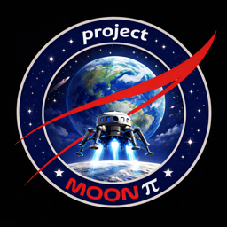

<b>Designed and Created by Project Moon Pi</b>

# Aviator Trail: tester downloads

Aviator Trail is an Oregon Trail-style game about becoming an airline pilot, from flight school to the left seat at a major. Thanks for helping test it!

## Download the version for your computer

| Your computer | Download this file | What it is |
|---|---|---|
| **Windows 10 or 11** | **[Install-Aviator-Trail-for-Windows.exe](https://github.com/projectmoonpi/aviator-trail-releases/releases/latest/download/Install-Aviator-Trail-for-Windows.exe)** | The installer, with the game inside (one file, about 390 MB) |
| **Mac** (Apple silicon or Intel) | **[Aviator-Trail-for-Mac.zip](https://github.com/projectmoonpi/aviator-trail-releases/releases/latest/download/Aviator-Trail-for-Mac.zip)** | The installer (small: it downloads the right app for your Mac) |
| Mac with **Apple silicon**, by hand | [Aviator-Trail-0.1.0-mac-arm64.dmg](https://github.com/projectmoonpi/aviator-trail-releases/releases/latest/download/Aviator-Trail-0.1.0-mac-arm64.dmg) | The app itself, to drag into Applications |
| Mac with an **Intel** processor, by hand | [Aviator-Trail-0.1.0-mac-x64.dmg](https://github.com/projectmoonpi/aviator-trail-releases/releases/latest/download/Aviator-Trail-0.1.0-mac-x64.dmg) | The app itself, to drag into Applications |

Most testers want the first two: the installers. These links always get the newest tester build. Aviator Trail plays in its own window, like any app. It needs nothing else: no Python, no web browser.

**Which Mac do I have?** Click the Apple menu › **About This Mac**. **Chip: Apple M…** means Apple silicon. **Processor: … Intel …** means Intel.

The [release page](https://github.com/projectmoonpi/aviator-trail-releases/releases/latest) lists these four files. It also lists **Source code (zip)** and **Source code (tar.gz)**: GitHub adds those to every release by itself. They hold only this download page, not the game, so you don't need them.

## Install it

**Windows**
1. Double-click `Install-Aviator-Trail-for-Windows.exe`. It's one file, so there's nothing to unzip.
2. Windows may show "Windows protected your PC", because the game isn't code-signed yet. Click **More info**, then **Run anyway**.
3. Choose where to install it and whether to put it on your Desktop, then click **Install** and **Finish**. Aviator Trail goes in your Start menu. It needs no admin rights.

**Mac** (macOS 13 or newer)
1. Unzip `Aviator-Trail-for-Mac.zip` and double-click **Install Aviator Trail**.
2. The first time, macOS may say it can't check the developer. Open **System Settings › Privacy & Security** and click **Open Anyway**. (Or right-click the installer, choose **Open**, then **Open**.)
3. It downloads the app for your Mac (about 330 MB), checks it, and puts it in **Applications**. The app itself may ask the same way the first time you open it.

To install by hand instead, open the `.dmg` for your Mac from the table above and drag **Aviator Trail** into **Applications**.

The first start needs the internet. Each time you open the game you'll see a short tester agreement, with the date this build stops working: tick the box and click **Agree and continue**.

## Updates

Each time it starts, the game checks for a newer tester build. If there is one, it shows **Update needed**:
- **Update now** downloads the new installer, checks it and opens it.
- The installer closes the game and updates it.

Your saved games and Hall of Fame carry on. Running the installer again also offers **Update**, **Repair** and **Reinstall from scratch**.

Each tester build works for 15 days.

## Uninstall

- **Windows:** Settings › Apps › Installed apps › Aviator Trail › Uninstall. It asks whether to delete your saved games too; leave the box unticked to keep them.
- **Mac:** drag Aviator Trail from Applications to the Trash.

## Found a bug?

Please tell the person who sent you this link what happened, what you were doing and which computer you were on. Screenshots help.

## Other files

`latest.json` in this repository is the small file the game reads to check for updates.

## Credits

- Game, artwork, code and original music: Project Moon Pi.
- Ending music (OpenGameArt, CC0 1.0): "It Takes a Hero" and "Stumble Around" by Zane Little Music, "Wacky Workings" by fupi, "8-bit - I am not clumsy!" by HydroGene, "Banana Track" by skrjablin.
- Story intro music: ["Pushing ahead"](https://opengameart.org/node/123082) by Centurion_of_war (OpenGameArt, CC0 1.0). Title and main menu music: ["Bit Forest intro"](https://opengameart.org/node/112117) by bertsz (OpenGameArt, CC0 1.0).
- Real instruments in the music: University of Iowa Electronic Music Studios, Musical Instrument Samples (free to use without restrictions), and VS Chamber Orchestra 2 Community Edition by Versilian Studios (CC0).
- Built with Claude Code (Anthropic).

Aviator Trail is a work of fiction and parody. It is not affiliated with any airline, flight school, union or the makers of *The Oregon Trail*.
